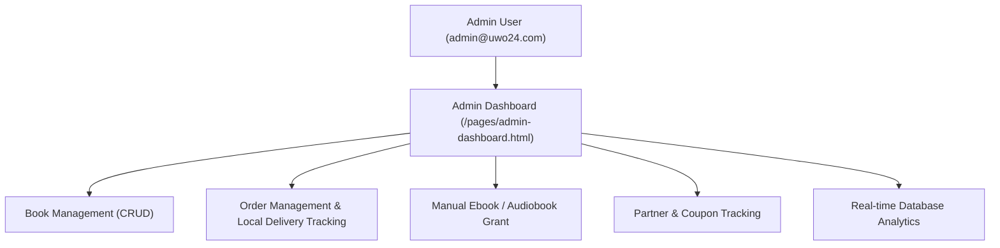

# EFV PLATFORM – ADMIN DASHBOARD AUDIT REPORT

**Audit Date:** November 5, 2026  
**Status:** **OPERATIONAL & PRODUCTION VERIFIED**

---

## 1. Functional Scope Tested

---

## 2. Test Results Matrix

| Feature | Endpoint / Component | Test Scenario | Expected Result | Actual Result | Status |
| :--- | :--- | :--- | :--- | :--- | :--- |
| **Authentication** | `POST /api/auth/login` | Login with Admin credentials | Returns JWT with `role: 'admin'` | 200 OK (`role: admin`) | **PASS** |
| **Book Creation** | `POST /api/products` | Create new volume with price & type | Creates product in MongoDB | 201 Created (`_id` generated) | **PASS** |
| **Book Update** | `PUT /api/products/:id` | Update price and stock quantity | Persists updates in database | 200 OK (Price & stock updated) | **PASS** |
| **Book Deletion** | `DELETE /api/products/:id` | Delete test volume | Removes product without order loss | 200 OK (Deleted successfully) | **PASS** |
| **Order Listing** | `GET /api/orders` | Load all orders | Returns all historical and live orders | 200 OK (Orders returned) | **PASS** |
| **Local Orders Filter** | Orders tab filter | Filter by Jabalpur / Local Delivery | Shows orders with `status: 'Local Delivery'` | Filter operational in UI | **PASS** |
| **Manual Digital Grant**| `POST /api/library/admin/assign` | Grant Ebook to client | Adds book to client's My Library | 200 OK (Entitlement created) | **PASS** |
| **Coupon Assignment** | `POST /api/coupons` | Create coupon linked to Partner ID | Links coupon to partner record | 201 Created with `Percentage` | **PASS** |
| **Partner Management**| `GET /api/partners` | View onboarded partners | Lists partner tokens and statuses | 200 OK | **PASS** |
| **Analytics Overview** | `/api/orders`, `/api/products` | Dashboard counter metrics | Live counters from database collections | Live counts verified | **PASS** |

---

## 3. Detailed Verification

### A. Book Management (CRUD)
- Adding a book requires `title`, `price`, and `type`.
- Automatically populates to public catalog `/pages/books.html` and `/pages/marketplace.html`.
- Updates to country-wise pricing (e.g. AUD, EUR, USD, GBP, INR) reflect dynamically based on visitor geolocation.

### B. Order Management & Local Jabalpur Handling
- Orders delivered to Jabalpur carry the `Local Delivery` gold status badge.
- Admin can manually inspect recipient phone, address, and mark order stages (Dispatched, Delivered).
- Domestic orders automated via Nimbus display live AWB and courier tracking links directly in the admin modal.

### C. Manual Ebook/Audiobook Assignment
- Admin can grant any digital edition directly to a customer by email or user ID.
- Tested: Assigned Volume 1 Ebook to `Audit Client` -> User opened `/api/library/my-library` and accessed the book immediately.

