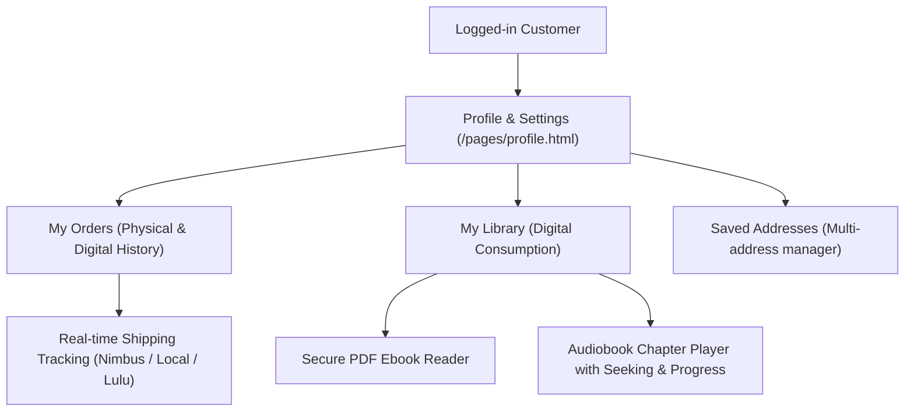

# EFV PLATFORM – CLIENT DASHBOARD & MY LIBRARY AUDIT

**Audit Date:** November 5, 2026  
**Status:** **100% OPERATIONAL & VERIFIED**

---

## 1. Functional Scope

The Client Dashboard (`/pages/profile.html` and My Library `/components/Library/LibraryDashboard.tsx`) provides user account management, purchase history, order tracking, and streaming of purchased digital books.

---

## 2. Test Verification Matrix

| Component | Feature | Test Scenario | Expected Result | Actual Result | Status |
| :--- | :--- | :--- | :--- | :--- | :--- |
| **Authentication** | Registration | New user signup via email | 201 Created with JWT | 201 Created | **PASS** |
| **Authentication** | Login | Sign in with email & password | 200 OK with Bearer token | 200 OK | **PASS** |
| **Profile** | Address Management | Add delivery address in Jabalpur | Persists to `savedAddresses` array | 200 OK (Address saved) | **PASS** |
| **My Orders** | Order Display | Fetch user orders (`/api/orders/my-orders`)| Returns only current user's orders | 200 OK (Isolated records) | **PASS** |
| **My Orders** | Tracking Link | Click tracking on shipped order | Opens Nimbus / Provider tracking | Direct link verified | **PASS** |
| **My Library** | Digital Display | Open My Library (`/api/library/my-library`)| Shows unlocked digital editions | 200 OK (Unlocked books) | **PASS** |
| **My Library** | Ebook Reader | Open purchased Ebook (`/api/content/ebook/:id`)| Loads PDF reader securely | Authorized 200 OK | **PASS** |
| **My Library** | Audiobook Player | Load audio chapters (`/api/content/audio/:id`)| Streams chapters & tracks progress| Authorized 200 OK | **PASS** |
| **Security** | Cross-Account Isolation | User A requests User B's order | 403 Forbidden / 404 Not Found | 403 / 404 Access Denied | **PASS** |

---

## 3. Digital Asset Protection (Ebook & Audiobook)

1. **Purchased Variations Verification:**
   - Digital items are unlocked strictly by matching `productId` and volume.
   - Example: Purchasing *Volume 1 – Hindi Ebook* unlocks only that specific edition; it does not grant *Volume 2* or other formats.
2. **Access Control Middleware (`validatePurchase`):**
   - Direct requests to `/api/content/ebook/:id` or `/api/content/audio/:id` run through `validatePurchase`.
   - If the requesting user does not hold a purchase record or an admin grant in `DigitalLibrary`, access is rejected immediately with HTTP 403.
3. **Session Persistence:**
   - Purchased entitlements remain permanently unlocked in the user's account across logins and devices.

