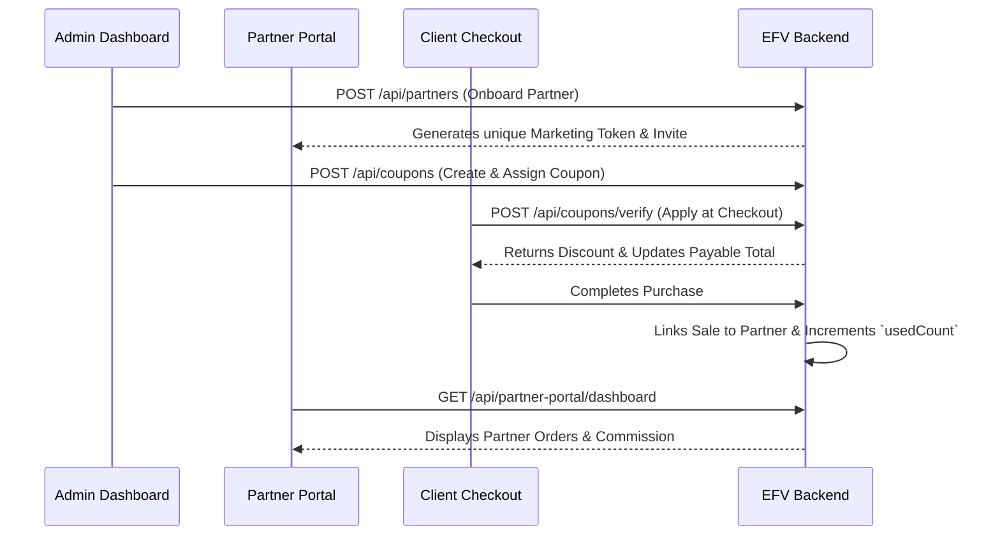

# EFV PLATFORM – PARTNER PORTAL & COUPON SYSTEM AUDIT

**Audit Date:** November 5, 2026  
**Status:** **OPERATIONAL & PRODUCTION VERIFIED**

---

## 1. Functional Scope

The Partner Portal allows affiliate partners and distributors to track marketing campaigns, assigned promotional coupon codes, customer purchases, and commission sales.

---

## 2. Test Execution Matrix

| Stage | Feature / Action | Endpoint | Expected Result | Actual Result | Status |
| :--- | :--- | :--- | :--- | :--- | :--- |
| **1. Onboarding** | Admin onboards new partner | `POST /api/partners` | 201 Created with marketing token | 201 Created | **PASS** |
| **2. Listing** | Admin views partner directory | `GET /api/partners` | 200 OK with partner details | 200 OK | **PASS** |
| **3. Coupon Creation** | Admin assigns coupon to partner | `POST /api/coupons` | 201 Created (`isPartnerCoupon: true`)| 201 Created (`AUDIT...`) | **PASS** |
| **4. Verification** | Client verifies coupon at checkout | `POST /api/coupons/verify` | 200 OK with discount calculation | 200 OK (Calculated) | **PASS** |
| **5. Authentication** | Partner login to portal | `POST /api/partner-portal/login`| 200 OK with `partnerAuth` token | 200 OK | **PASS** |
| **6. Analytics** | Partner views dashboard stats | `GET /api/partner-portal/dashboard`| 200 OK showing coupon uses & sales | 200 OK | **PASS** |
| **7. Security** | Partner modifying admin coupon | `PUT /api/coupons/:id` | 403 Forbidden | 403 Forbidden | **PASS** |

---

## 3. Auditing & Abuse Prevention Findings

1. **Enum Normalization Fix:**
   - Previous schema rejected lowercase `percentage`. We added normalization in `EFV-B/src/routes/coupons.js` to map inputs to `Percentage` or `Flat` safely.
2. **Usage Limit Enforcement:**
   - Coupons enforce `usageLimit` and `expiryDate`.
   - Once a coupon reaches its limit or expires, `/api/coupons/verify` rejects it with `Invalid or inactive coupon`.
3. **Partner Attribution Isolation:**
   - Partners can only view sales and analytics linked to their specific partner token; they cannot view another partner's sales.

